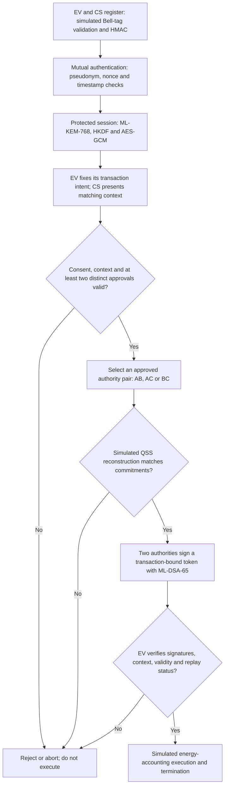

# QSV2G — Quantum-Safe Vehicle-to-Grid Authorization

**Research software and reproducibility archive accompanying the manuscript**

**Manuscript:** *QSV2G: Pseudonymous Cross-Domain Authentication and Quantum Secret Sharing-Based Authorization for Vehicle-to-Grid Networks*

**Authors:** Dr. Kumar Prateek · Shanmukh Datta  
**Research mentorship:** Dr. Kumar Prateek  
**Institution:** Dr. B R Ambedkar National Institute of Technology Jalandhar, India  
**Submission target:** [PPT-PQC 2027](https://sites.google.com/nitj.ac.in/ppt-pqc2027), International Workshop on Privacy-Preserving Techniques and Post-Quantum Cryptography for Pervasive Systems, co-located with **IEEE PerCom 2027**, Goa, India.  
**Status:** Research artifact prepared for manuscript submission; **not** a claim of paper acceptance, publication or external security certification. The [official workshop CFP](https://sites.google.com/nitj.ac.in/ppt-pqc2027/call-for-papers) lists **17 November 2026** as the submission deadline, a normal **six-page** limit, and an optional seventh page. Always check the official CFP for updates.

## Overview

QSV2G is a software research prototype for pseudonymous, cross-domain EV/charging-station authentication and transaction-bound **two-of-three utility-authority authorization**, combining:

- **Genuine post-quantum cryptography:** standardized ML-KEM-768 key establishment and ML-DSA-65 authority signatures, with HKDF, HMAC-SHA256 and AES-GCM traffic protection.
- **Mathematically simulated quantum mechanisms:** Bell-state encoding/decoding and ideal three-qutrit quantum secret sharing (QSS), with explicit noise-channel and reconstruction models.
- **Authenticated transaction intent:** the requested operation (CHARGE or DISCHARGE), energy bound, validity interval, nonces and session identifier are checked and bound to EV consent and signed authorization statements.
- **Reproducible experiments:** ideal reconstruction, fault injection, software performance, quantum-noise reliability, classical-sharing comparison, stateful tests, retry modeling and scoped Tamarin formal analyses.

**Scope:** No real EV, charger, electrical grid, quantum communication network, quantum hardware, distributed authority deployment or physical energy-transfer measurement was used. The EV verifies signed reconstruction **attestations**, not an independently checkable proof of physical quantum reconstruction. Software acceptance results are not a blanket security proof.

## Start here: QSV2G in plain English

Imagine an electric vehicle (EV) requesting permission to **charge or discharge** through a charging station (CS). QSV2G tries to ensure that the EV and station are authenticated, the EV agreed to the exact transaction, and **two distinct utility authorities** approved it. The selected authorities reconstruct a simulated quantum-shared secret before issuing digitally signed authorization.

**Who is involved?** `EV` = electric vehicle; `CS` = charging station; `UC-A`, `UC-B`, and `UC-C` = three logical utility authorities. All are represented inside **one Python process**. `QSS` = quantum secret sharing; `PQC` = post-quantum cryptography. Neither real vehicles nor physical quantum links are used.

### Protocol flowchart



**How to read the diagram:** The green path is not automatic: each verification must pass. A failed check stops the modeled transaction. Although **any approved pair** can perform the later 2-of-3 reconstruction, the present registration and initial participant-validation code specifically requires **UC-A and UC-B online**; it does *not* implement full one-authority-outage tolerance for the entire lifecycle.

**Where this happens in code:** [`src/qsv2g/protocol.py`](src/qsv2g/protocol.py) is the protocol state machine; [`src/qsv2g/crypto.py`](src/qsv2g/crypto.py) implements real classical/PQC software operations; [`src/qsv2g/quantum.py`](src/qsv2g/quantum.py) and [`src/qsv2g/resources.py`](src/qsv2g/resources.py) model quantum states, share reconstruction and single-use resources. The EV verifies **authority signatures on a reconstruction attestation**, not an independent cryptographic proof that physical quantum reconstruction took place.

### What is real, and what is simulated?

| Component | In this repository |
|---|---|
| ML-KEM-768 key establishment and ML-DSA-65 signatures | **Real software cryptography**, using `pqcrypto` or an appropriate OpenSSL backend |
| HMAC, HKDF and AES-GCM | **Real software cryptography** |
| Bell-state operations and three-qutrit QSS | **Mathematical NumPy simulation**, not a quantum-network experiment |
| Charging/discharging and utility authorities | **Logical software workflow**, not live grid control or physically separated services |
| Quantum noise, resource use and independent retries | **Modeled scenarios**; retry analysis is not a deployed retry mechanism |

### One transaction in practice

After installation, run `python scripts/run_protocol.py --pair AB --operation CHARGE --length 9`. It prints a JSON **trace** containing each protocol phase, the real PQC backend used, the final state, and simulated energy accounting. `TERMINATED` means this modeled workflow completed; `REJECTED` means a guard stopped it. A successful example is **not** proof of general protocol security.

---

## Repository organization

The **five main research directories** are organized by scientific purpose rather than the chronology of notebook development.

| Folder | Contents |
|---|---|
| [`src/qsv2g/`](src/qsv2g/) | Reusable cryptography, quantum models, protocol, state/resource management and evaluation libraries |
| [`scripts/`](scripts/) | One-session runner, configurable experiments, source-parity checks, archive-integrity verifier, Kaggle notebook and formal model wrappers |
| [`tests/`](tests/) | Unit, regression, genuine-PQC, model-property and experiment checks |
| [`results/`](results/) | Original submitted ZIP archives, preserved raw results, plots, prover logs and verification manifests |
| [`docs/`](docs/) | Methodology, trust/threat assumptions, limitations, reproducibility and manuscript-evidence mapping |

`pyproject.toml`, `CITATION.cff` and `.github/workflows/` provide package/repository metadata and continuous verification.

## Installation and reproducing experiments

Tested with Python 3.13; Python 3.11+ is recommended. A genuine ML-KEM-768 and ML-DSA-65 implementation is mandatory for cryptographic evaluation; `pqcrypto` is available through the optional `pqc` dependency, or an appropriate OpenSSL 3.5+ backend can be used.

```bash
git clone https://github.com/shanmukhdatta/QSV2G.git
cd QSV2G
python -m pip install -e ".[dev,pqc]"
python -m pytest -q tests
python scripts/check_parity.py
python scripts/verify_archived_evidence.py
```

Run an illustrative transaction or one type of experiment:

```bash
python scripts/run_protocol.py --pair AB --operation CHARGE --length 9
python scripts/run_experiment.py --study validation
python scripts/run_experiment.py --study security
python scripts/run_experiment.py --study noise
python scripts/run_experiment.py --study performance
python scripts/run_experiment.py --study availability
python scripts/run_experiment.py --study security-stateful
python scripts/run_experiment.py --study security-adversarial
python scripts/run_experiment.py --study reliability
python scripts/reproduce_all.py
```

Default experimental runs are **bounded smoke tests**. Add `--full` to `scripts/run_experiment.py` for much larger workloads. New outputs are written under the ignored `results/generated/` directory, **separate from** the preserved original Kaggle outputs. Run the same modular package on Kaggle using [`scripts/kaggle_runner.ipynb`](scripts/kaggle_runner.ipynb). Formal models additionally require separately installed Tamarin and Maude executables. Successful Python tests do not replace a formal security proof.

## Original experimental evidence

**The original Kaggle ZIPs are committed unchanged**, including full result matrices, original numeric CSVs, run metadata and complete formal-prover logs. The first four historical experimental archives were already present; the **full software-evaluation** and **security/reliability-evaluation** ZIPs are now added in their original filenames. Every listed archive can be checked locally with `python scripts/verify_archived_evidence.py`.

| Evaluation | Preserved archive | Principal recorded evidence |
|---|---|---|
| Baseline & ideal QSS correctness | [`ideal_validation_historical.zip`](results/archives/ideal_validation_historical.zip) | 38/38 **expected outcomes**, including explicit known-limit cases; 720/720 ideal share reconstructions; 6 accepted and terminated control workflows |
| Security/fault-injection campaign | [`security_scenarios_historical.zip`](results/archives/security_scenarios_historical.zip) | 80/80 expected observations, with **7 documented security/implementation limitations** |
| Quantum noise & single-trit fidelity | [`quantum_noise_historical.zip`](results/archives/quantum_noise_historical.zip) | 315,000 **modeled measurement trials** across five channel models; not real quantum-network transmissions |
| Software performance & classical authorization controls | [`performance_historical.zip`](results/archives/performance_historical.zip) | 120 complete software workflows, 120 QSS scaling runs, 270 post-context authorization microbenchmarks |
| Full matched software and endpoint evaluation | [`qsv2g_stage05_final_20261113T092554Z.zip`](results/archives/qsv2g_stage05_final_20261113T092554Z.zip) | 18,000 software transactions; 36 scripted attack outcomes; 300,000 modeled vector attempts; 6,000 real-PQC endpoint attempts; 11 failure scenarios; **4 limited abstract Tamarin lemmas** |
| Adversarial comparison, retries & extended formal model | [`qsv2g_stage06_full_20261113T111031Z_results.zip`](results/archives/qsv2g_stage06_full_20261113T111031Z_results.zip) | 96 QSS/classical attack cases; nine exact measurement-basis comparisons; 400 retry configurations; **3 abstract Tamarin lemmas, including a compromise-induced bypass trace** |

### Which results should a new reader open first?

Begin with the [claim-to-evidence map](docs/PAPER_EVIDENCE_MAP.md), then consult the [archive guide](results/archives/README.md). You do **not** need to unpack every ZIP to understand the main findings.

| Question | Evidence to inspect | Interpretation |
|---|---|---|
| Does ideal 2-of-3 reconstruction work? | `ideal_validation_historical.zip` → `validation/qss_pair_ideal.csv` | Ideal simulated correctness, not security against arbitrary attackers |
| What attacks were tried? | `security_scenarios_historical.zip` → `security_attack_results.csv`; Stage 05 ZIP → `e2/e2_cases.csv` | Expected outcomes include rejected attacks **and known vulnerabilities** |
| How does software latency compare? | `performance_historical.zip` → `end_to_end_raw.csv`; Stage 05 ZIP → `e1/e1_trials.csv` | Measured **software** workloads; no network, charging hardware or quantum link timing |
| What happens under noise? | `quantum_noise_historical.zip` → `noise_trial_aggregates.csv`; Stage 05 ZIP → `e3/e3_vector_trials.csv` | The first is sampled **single-trit** behavior; the second is **full-vector** gate behavior; do not mix denominators |
| What happens when authorities are compromised? | Stage 06 ZIP → `p0_p1/p0_p1_attack_matrix.csv` | Includes a conditional bypass requiring **two selected signing keys plus privileged CS state** |
| What can retries improve? | Stage 06 ZIP → `p2/p2_retries.csv` | Analytical/Monte Carlo availability and qutrit-cost trade-off; **retries are not implemented** in the live state machine |

**ZIP integrity versus scientific validity:** The SHA-256 manifest records the exact archived ZIP bytes, and `python scripts/verify_archived_evidence.py` checks checksums, CRCs and relevant internal file manifests. Passing that check establishes file integrity against recorded hashes; it does **not** independently validate Kaggle execution, replicate historical numbers, prove security or verify the manuscript's interpretation. The historical archives were generated from **different source revisions**. Please keep them unchanged and label any fresh reruns separately.

**How to reproduce a small test:** `python scripts/run_experiment.py --study security` writes new CSVs under `results/generated/security/`. Other study names include `validation`, `noise`, `performance`, `availability`, `security-adversarial` and `reliability`. These default to **smoke budgets**; `--full` requests much larger experiments. A new run is not automatically a numerical reproduction of a historical archive.

**Critical interpretation:** A test matching an *expected* outcome may deliberately demonstrate a security limitation; it is not automatically a successful defense. The signature/charging-station compromise case in the final archive requires both selected authority signing keys **and privileged station-state control**; it is not evidence of a remote-only attack. The full-vector noise and retry outcomes are *models*, not deployed network availability. The formal verification establishes only the stated properties of limited symbolic abstractions. No experimentally established QSS security advantage over matched classical two-of-three sharing is claimed.

- **Archive directory:** [`results/archives/`](results/archives/) — original ZIPs, provenance, file hashes and instructions.
- **Paper claim-to-evidence map:** [`docs/PAPER_EVIDENCE_MAP.md`](docs/PAPER_EVIDENCE_MAP.md) — which CSV or prover log supports each reported result and its caveats.
- **Machine-readable checksums:** [`results/manifests/kaggle_archive_sha256.json`](results/manifests/kaggle_archive_sha256.json) — complete SHA-256 hashes for the six principal experimental ZIPs.
- **Methodology:** [`docs/methodology.md`](docs/methodology.md); **threat model:** [`docs/threat_model.md`](docs/threat_model.md); **limitations:** [`docs/limitations.md`](docs/limitations.md).

## Source versions and reproducibility boundaries

Historical results were collected with *different protocol revisions*. The older validation/noise/performance notebooks used an earlier source snapshot; the full software evaluation records Git revision `b463fc758fa28f1853fe06c4130ee2f25173ac0c`; the later adversarial study records `2860ab3b0137c68e58fe1195a4c71a82a60ce183`. **Do not assign measurements from these ZIPs to the present modular code without a matched rerun.** The present core refactor preserves the original functions/classes structurally and is exercised by GitHub CI, but full historical numerical reruns are not asserted.

All original notebooks, audit notes and development history are recoverable from the [`archive/pre-modularization-2026-11-14`](https://github.com/shanmukhdatta/QSV2G/tree/archive/pre-modularization-2026-11-14) branch. Environment fields within submitted ZIPs indicate reported Kaggle execution, but original immutable Kaggle run URLs/version IDs are not all independently available. Consult [`docs/reproducibility.md`](docs/reproducibility.md) for details.

## Paper submission and citation

This repository is prepared as a **supporting reproducibility artifact** for a planned submission to PPT-PQC 2027. It is **not** itself the workshop manuscript or an upload to the paper submission system. The workshop's current instructions (page limit, reviewing/anonymity, paper-format requirements and official submission link) must be followed separately. **Before putting this author-identifying public repository URL in a submitted PDF, verify the workshop's own anonymity and conflict-of-interest policies.** The main PerCom call describes double-blind review, while the workshop page should be treated as the authority on workshop-specific rules. Do not assume the policies are interchangeable. See [`docs/SUBMISSION_READINESS.md`](docs/SUBMISSION_READINESS.md).

For attribution, see [`CITATION.cff`](CITATION.cff). There is no claimed DOI or acceptance notice. Copyright/license permissions must be agreed by the authors before a public reuse license is added.
