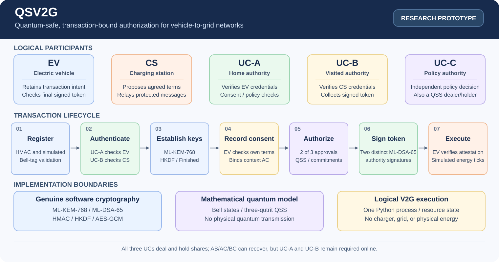

# QSV2G

<p align="center"><strong>Pseudonymous Cross-Domain Authentication and Quantum Secret Sharing-Based Authorization for Vehicle-to-Grid Networks</strong></p>

<p align="center">
  
  
  
  
</p>

<p align="center"><strong>Shanmukh Datta</strong> &nbsp;&middot;&nbsp; <strong>Kumar Prateek</strong></p>
<p align="center">Dr. B. R. Ambedkar National Institute of Technology Jalandhar, Punjab, India</p>

<p align="center">
  <a href="#system-architecture">Architecture</a> &nbsp;&middot;&nbsp;
  <a href="#key-experimental-findings">Results</a> &nbsp;&middot;&nbsp;
  <a href="#reproducibility">Reproducibility</a> &nbsp;&middot;&nbsp;
  <a href="#research-evidence">Evidence</a> &nbsp;&middot;&nbsp;
  <a href="CITATION.cff">Citation</a>
</p>

> **Research status:** QSV2G is an experimental software artifact, not a deployed V2G network or an accepted/published paper. No quantum security advantage or independent proof of physical reconstruction is claimed.

## Overview

QSV2G investigates how a roaming electric vehicle (EV) can authenticate across utility domains, consent to the *exact* charge/discharge transaction, and obtain authorization from **two distinct utility authorities**. It combines genuine ML-KEM-768 and ML-DSA-65 cryptographic software with an idealized **2-of-3 qutrit secret-sharing model**.

The EV and charging station (CS) are checked through UC-A and UC-B. UC-A, UC-B and UC-C each act as QSS dealers and share holders. An approved pair (AB, AC or BC) can reconstruct the modeled dealer contributions, validate commitments and issue two signed authorization attestations. The EV checks the token and the terms it previously consented to. **The signatures attest to recovery; they do not independently prove that quantum reconstruction occurred.**

## System architecture

<p align="center">
  
</p>

*Figure: Reference implementation architecture. The actors coexist in one Python process; the diagram is a logical workflow, not a physical network topology.*

**Implementation boundary:** ML-KEM, ML-DSA, HMAC, HKDF and AES-GCM are genuine software cryptographic operations. Bell-state handling, three-qutrit QSS, quantum noise and energy transfer are simulated or modeled. Although any approved pair can reconstruct, **UC-A and UC-B remain necessary for authentication** in the current workflow.

## Key experimental findings

| Evaluation | Observed result | What it establishes |
| --- | --- | --- |
| Ideal reconstruction | **720 / 720** successful ideal pair recoveries | Correctness under honest ideal states, not malicious-secure QSS |
| Controlled adversarial evaluation | **96 / 96** observations matched their expected controls | Includes rejected alterations **and demonstrated compromise-dependent bypasses** |
| Full-vector noise | **300,000** modeled trials; 191,736 commitment-gate eligible | Modeled vector reliability, not a quantum-network success rate |
| Endpoint checks | **6,000** genuine-PQC trials; 3,854 EV acceptances | Software endpoint behavior under the selected conditions |
| Matched software performance | **18,000** transactions; at L=162, QSS **88.41 ms**, classical sharing **64.81 ms** | QSS had **36.4%** greater median inclusive software time at that length |
| Symbolic verification | Restricted Tamarin/Maude models | Scoped consent/single-use properties; a bypass trace under both signer-key compromises plus privileged CS state |

These are **separate experimental cohorts**. Passing an expected test does not necessarily mean an attack was prevented. No claim of stronger security than a matched classical threshold solution follows from these results.

## Repository structure

```text
QSV2G/
├── src/qsv2g/         # Protocol, genuine crypto, qutrit/QSS models, evaluation
├── scripts/           # Demo runs, experiments, parity and archive checks
├── tests/             # Regression, PQC and controlled experiment tests
├── formal/            # Restricted Tamarin symbolic models
├── results/           # Original archived runs, raw outputs and figures
├── assets/            # The vector architecture diagram
├── .github/workflows/ # Automated checks
├── pyproject.toml     # Python project and optional dependencies
└── CITATION.cff       # Software citation metadata
```

## Reproducibility

Python **3.10+** is declared; Python 3.11+ is recommended. Install the optional `pqc` dependency for a genuine `pqcrypto` backend. An appropriate supported OpenSSL backend is an alternative; genuine-PQC experiments do not silently substitute classical cryptography.

```bash
git clone https://github.com/shanmukhdatta/QSV2G.git
cd QSV2G
python -m pip install -e ".[dev,pqc]"
python -m pytest -q tests
python scripts/run_protocol.py --pair AB --operation CHARGE --length 9
```

To run bounded experiments, then verify the identity of preserved historical archives:

```bash
python scripts/run_experiment.py --study validation
python scripts/run_experiment.py --study security-adversarial
python scripts/run_experiment.py --study noise
python scripts/run_experiment.py --study performance
python scripts/run_experiment.py --study reliability
python scripts/check_parity.py
python scripts/verify_archived_evidence.py
```

Experiment runners default to **small smoke-test budgets** and write new output to `results/generated/`. `--full` requests larger workloads; it does not automatically reproduce every historical trial exactly. Tamarin and Maude require separate installation; see [`formal/README.md`](formal/README.md).

## Research evidence

The original research outputs remain available, including archived ZIPs, source-run metadata, CSV results, plots and formal logs. Useful starting points:

| Evidence | Location |
| --- | --- |
| Ideal pair recovery and validation controls | [`results/raw/validation/`](results/raw/validation/) |
| Single-trit noise and classical-basis measurements | [`results/raw/noise_earlier/`](results/raw/noise_earlier/) |
| Software timings and classical controls | [`results/raw/performance_earlier/`](results/raw/performance_earlier/) |
| Adversarial and retry experiments | [`results/raw/security_research/`](results/raw/security_research/) |
| Original run archives and checksum provenance | [`results/archives/`](results/archives/) and [`results/manifests/kaggle_archive_sha256.json`](results/manifests/kaggle_archive_sha256.json) |

**Versioning caution:** Different historical evaluations were executed with different protocol/source revisions. Checksums establish archive integrity relative to recorded hashes, not independent reproducibility or security. Do not attribute old benchmark values to the current refactored code without a matched rerun.

## Security and scope limitations

QSV2G does **not** implement real quantum channels, grid hardware, independently deployed authorities, crash-durable replay/nonce state, malicious-secure verifiable QSS, or an endpoint-verifiable proof of reconstruction. Reported formal properties hold only in the stated symbolic abstractions. A demonstrated bypass requires two compromised authority signing keys **and privileged station-side control**, beyond the assumed one-corrupt-authorizer bound.

## Citation and project status

Cite the software using [`CITATION.cff`](CITATION.cff). The manuscript is maintained separately from this branch; no publication, DOI, venue acceptance, or third-party security certification is asserted here. This public repository and its earlier branches/archival ZIPs should not be treated as confidential manuscript storage.

No license or unrestricted redistribution permission is implied by the absence of a `LICENSE` file. Please contact the authors regarding reuse.
